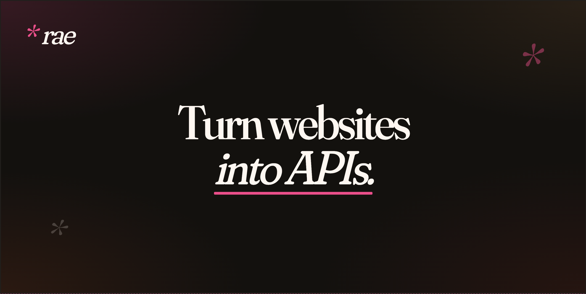

<div align="center">
  
  <br><br>
  <a href="https://pypi.org/project/reverse-api-engineer/"></a>
  <a href="https://www.python.org/downloads/"></a>
  <a href="https://opensource.org/licenses/MIT"></a>
  <a href="https://github.com/kalil0321/reverse-api-engineer/actions/workflows/ci.yml"></a>
  <br>

[](https://www.greptile.com/?utm_source=oss_badge&utm_medium=readme&utm_campaign=greptile_for_open_source)

</div>

# Reverse API Engineer

> **Turn websites into APIs.** Browse (or let an agent browse), and get a clean, typed client for the endpoints the site actually uses.

<p align="center">
  
  <br>
  <em>Agent mode</em>
</p>

<p align="center">
  
  <br>
  <em>Manual mode</em>
</p>

---

## How it works

1. You give it a website and a goal ("fetch all Apple jobs").
2. A browser visits the site, either driven by you or by an AI agent.
3. Network traffic is captured to a HAR file.
4. Your configured model reads the traffic and writes a working API client in Python, JavaScript, TypeScript, Go, Java, C#, PHP, Ruby, C, or PowerShell.

No more manually opening DevTools, copying cURL commands, and gluing together a client.

## Install

```bash
uv tool install reverse-api-engineer   # or: pip install reverse-api-engineer
```

The secured cryptography dependency no longer supports Intel macOS or 32-bit Windows. Use Linux (including on Intel hardware), Apple Silicon macOS, or 64-bit Windows. Installing on the retired platforms may attempt an unsupported source build requiring Rust and OpenSSL development tools; this is not a supported installation path. Do not downgrade cryptography to restore old wheels. See the [upstream platform changes](https://cryptography.io/en/latest/changelog/#v49-0-0).

Agent mode (the default) captures through `npx`-launched browser tooling —
browser MCP servers (Playwright or Chrome DevTools) or the Vercel `agent-browser`
CLI — and needs no extra Python packages. **Manual mode** drives a local
Playwright browser, which ships in the optional `[manual]` extra:

```bash
uv tool install "reverse-api-engineer[manual]"   # or: pip install "reverse-api-engineer[manual]"
playwright install chromium
```

### Use it from your coding agent

Install the skill so Claude Code, Codex, Cursor, OpenCode and other agents know how to drive the CLI:

```bash
npx skills add kalil0321/reverse-api-engineer
```

Then ask your agent for what you need, for example "get me a typed client for the job search on this careers page". The skill lives in [`skills/reverse-api-engineer`](skills/reverse-api-engineer/SKILL.md).

## Quick start

```bash
reverse-api-engineer
> fetch all apple jobs from their careers page

# Browser opens. Navigate, interact, close when done.
# → ./scripts/apple_jobs_api/  (api_client.py, README.md, example_usage.py)
```

Cycle modes with **Shift+Tab**:

| Mode | What it does |
|------|--------------|
| `manual` | You drive the browser; AI generates the client from captured traffic. |
| `agent` | An AI agent drives capture autonomously (Playwright or Chrome MCP, or Vercel agent-browser CLI). |
| `engineer` | Re-run generation on a previous capture (`engineer <run_id>`). Needs a HAR, so it works on `auto`, `agent-browser` and manual runs, not chrome-mcp runs. |
| `collector` | Agent collects structured data (JSON/CSV) using web search + fetch. |

Agent mode providers:
- **chrome-mcp** (default for new configs; an existing `config.json` keeps its provider): drives your real Chrome so you keep existing sessions/cookies. Needs Node.js 20.19+; headed runs also need Chrome 146+ open with auto-connect enabled at `chrome://inspect/#remote-debugging`, and someone at the machine to accept Chrome's connection prompt when the run starts. For headed runs, rae checks before launching that Chrome's remote debugging port is reachable (not the Chrome or Node version) and stops with setup steps if it isn't; `agent --dry-run` shows the same check. Headless runs skip it. `--headless` starts a separate headless Chrome without your sessions. No HAR file is saved, so `engineer <run_id>` cannot regenerate these runs; run `agent` again instead.
- **auto**: Playwright MCP, records a HAR and needs no Chrome setup.
- **agent-browser**: [Vercel agent-browser](https://github.com/vercel-labs/agent-browser) **CLI** (not a Reverse API Engineer browser MCP server). At session start RAE uses whatever `agent-browser` is already on `PATH`, otherwise runs **`npm install -g <pin>`** (same pin as config / `RAE_AGENT_BROWSER_PACKAGE`), prints a yellow notice, validates with **`--help`**, and only then falls back to **`npx -y <pin>`** if npm cannot install. Prompts embed the resolved shell prefix alongside **`skills get core --full`**, **`skills list`**, HAR phases, cloud notes from `agent_browser_notes`. Tune with `agent_browser_npx_package` (optional), env `RAE_AGENT_BROWSER_*`. First Chromium fetch: **`agent-browser install`** (add `--with-deps` on trimmed Linux).


Optional sanity checks:

```bash
agent-browser doctor --offline --quick || true
agent-browser skills list >/dev/null
```

## Configuration

Settings live in `~/.reverse-api/config.json` and can be edited via `/settings` in the CLI:

```json
{
  "agent_provider": "chrome-mcp",
  "agent_browser_npx_package": "agent-browser@0",
  "agent_browser_notes": "",
  "claude_code_model": "claude-sonnet-4-6",
  "claude_setting_sources": [],
  "collector_model": "claude-sonnet-4-6",
  "ollama_auto_start": true,
  "ollama_base_url": "http://127.0.0.1:11434",
  "opencode_auto_start": true,
  "opencode_base_url": "http://127.0.0.1:4096",
  "opencode_model": "big-pickle",
  "opencode_npx_package": "opencode-ai@latest",
  "opencode_provider": "opencode",
  "copilot_model": "gpt-5",
  "cursor_model": "composer-2.5",
  "output_dir": null,
  "output_language": "python",
  "real_time_sync": true,
  "sdk": "claude"
}
```

- **Models**: Sonnet 5.5, Opus 5.5 (most capable), Opus 4.6 and Haiku 5.5 (fastest). Sonnet 4.6 stays the default until you choose another; it and Haiku 4.5 are still accepted in config and by `--model`. For OpenCode see [models.dev](https://models.dev).
- **SDK**: `claude` (default), `opencode`, `cursor`, or `copilot` (GitHub Copilot).
- **Claude settings isolation**: Claude sessions don't load your Claude Code settings files, `CLAUDE.md`, hooks, plugins, permission rules or MCP servers, so your personal setup doesn't steer the agent. Organization-managed policy still applies, and Claude Code still reads its own state such as `~/.claude.json` and auto memory. If `~/.claude/settings.json` provides your authentication (`apiKeyHelper`, or Bedrock, Vertex or proxy variables under `env`), set `claude_setting_sources` to the layers to load, e.g. `["user"]` or `["user", "project", "local"]`. Each layer you list is loaded in full, including its hooks, plugins, permission rules and MCP servers.
- **OpenCode setup**: with `sdk: "opencode"`, RAE reuses an existing server or downloads/starts `opencode-ai@latest` through `npx`; a global OpenCode installation is not required. Fresh configurations default to the free `opencode/big-pickle` model. `/settings` shows a loading spinner, then offers a searchable **OpenCode Provider / Model** picker populated from the server's connected, tool-capable catalog and marks free OpenCode options. Before creating a session, RAE validates the saved pair again and suggests currently available free models when configuration is invalid. Compatible older servers are reused with a version warning. Node.js 20+ is required for automatic startup. Password-protected servers use `OPENCODE_SERVER_PASSWORD` and optional `OPENCODE_SERVER_USERNAME`. Override startup with `OPENCODE_BASE_URL`, `RAE_OPENCODE_PACKAGE`, or `RAE_OPENCODE_AUTO_START=0`.
- **Ollama through OpenCode**: choose provider `ollama` in `/settings`; RAE starts an installed Ollama daemon if needed, lists only installed models with tool calling and 64k+ context, and supplies OpenCode's provider config inline. Models are never downloaded silently. Override with `RAE_OLLAMA_BASE_URL` or `RAE_OLLAMA_AUTO_START=0`.
- **Output language**: `python`, `javascript`, `typescript`, `go`, `java`, `csharp`, `php`, `ruby`, `c`, or `powershell`. C needs a POSIX toolchain (`cc`, libcurl headers) — macOS/Linux, or WSL/MSYS2 on Windows. PowerShell needs `pwsh` 7+ (PowerShell Core, not Windows PowerShell 5.1). Its runner executes the generated `Example.ps1` beside `api_client.psm1`; argument overrides are not supported. Edit the example or import the module to call its exported functions with your own arguments.

## CLI

`reverse-api-engineer` opens a full-screen session; `agent`, `engineer` and `collector` open it too when run in a terminal (`agent` and `engineer` stay plain with `--json` or `--no-interactive`). Type `/` for the commands:
- `/model`, `/effort`, `/mode`: switch the model, how hard it thinks, and the mode (also Shift+Tab, ctrl+e).
- `/settings`: SDK, agent provider, output and sync settings.
- `/history`: past runs, with their details, messages, and re-engineer or resume.
- `/messages [run_id]`: what the agent did in a run.
- `/resume [run_id]`: continue a past run's conversation where it stopped, on any SDK. Works for runs that saved their SDK session: agent and engineer runs from this version on. Collector runs cannot be resumed.
- `/output` (ctrl+o): everything from the session, unfolded. `/open`: the latest client.
- `/new`, `/clear`, `/help` (or `/commands`), `/exit` (or `/quit`).

Scriptable subcommands (pipe to `jq`):

```bash
reverse-api-engineer agent --prompt "capture the public jobs api" \
  --url https://example.com/jobs --json | jq

reverse-api-engineer list --json
reverse-api-engineer show <run_id> --json
reverse-api-engineer run <run_id> --file api_client.py \
  --no-interactive --auto-install -- --org acme
```

Pass `--no-interactive` (and/or `--json`) to skip prompts. With `--json`, stdout is one JSON document and logs go to stderr.

### `agent --json` schema

| Field            | Type                | Notes                                                                  |
|------------------|---------------------|------------------------------------------------------------------------|
| `schema_version` | `int`               | Currently `1`.                                                         |
| `status`         | `"ok"` \| `"error"` | Top-level result.                                                      |
| `run_id`         | `string` \| `null`  | Use with `show` / `engineer` / `run`.                                  |
| `prompt`         | `string`            |                                                                        |
| `url`            | `string` \| `null`  |                                                                        |
| `mode`           | `string` \| `null`  | `"auto"`, `"chrome-mcp"`, or `"agent-browser"`.                                        |
| `har_path`       | `string` \| `null`  | Captured HAR.                                                          |
| `script_path`    | `string` \| `null`  | Generated client; exists whenever `status` is `"ok"`.                 |
| `usage`          | `object`            | `{input_tokens, output_tokens, cache_read_tokens, cache_write_tokens, total_cost_usd}`, each present only when the SDK reports it, plus the SDK's own usage under `raw`. |
| `error`          | `string` \| `null`  | When `status == "error"`.                                              |

### Exit codes

| Code | Meaning |
|------|---------|
| `0` | Success. |
| `1` | Runtime error. |
| `2` | Missing required arg under `--no-interactive` / `--json`. |

For `run`, the exit code is the underlying script's return code on success, `1` if no script was found, or non-zero if `--no-interactive` would have had to prompt.

### Debugging agent failures

Set the `RAE_DEBUG` environment variable to `1` to print the Python traceback
for unexpected agent capture failures to stderr. Normal error messages remain
concise by default, and `--json` / `--json-stream` stdout remains machine-readable.

## Output locations

- `~/.reverse-api/runs/scripts/{run_id}/`: permanent storage
- `./scripts/{descriptive_name}/`: local copy with a readable name
- Collector: `./collected/{folder_name}/` (`items.json`, `items.csv`, `README.md`)

## Caveats

- Generated code runs locally via Claude Code, so review before executing.
- Sites with aggressive bot detection may block capture or require manual interaction.

## Development

```bash
git clone https://github.com/kalil0321/reverse-api-engineer.git
cd reverse-api-engineer
uv sync
uv run reverse-api-engineer
```

Build: `./scripts/clean_build.sh`. Requires Python 3.11+ and an API key for agent mode. Manual mode additionally needs the `[manual]` extra plus `playwright install chromium`.

## License

MIT. See [LICENSE](LICENSE).
